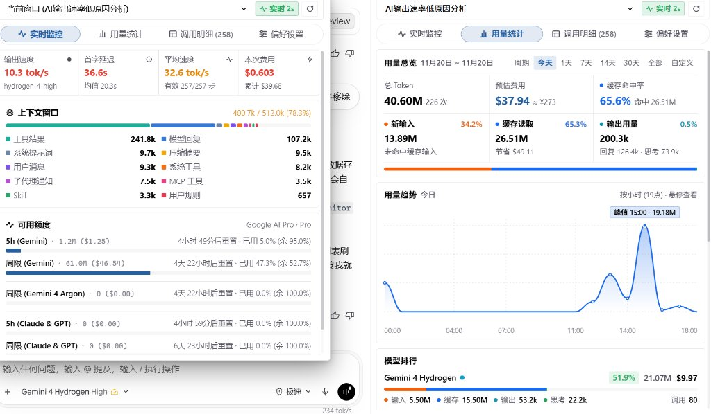
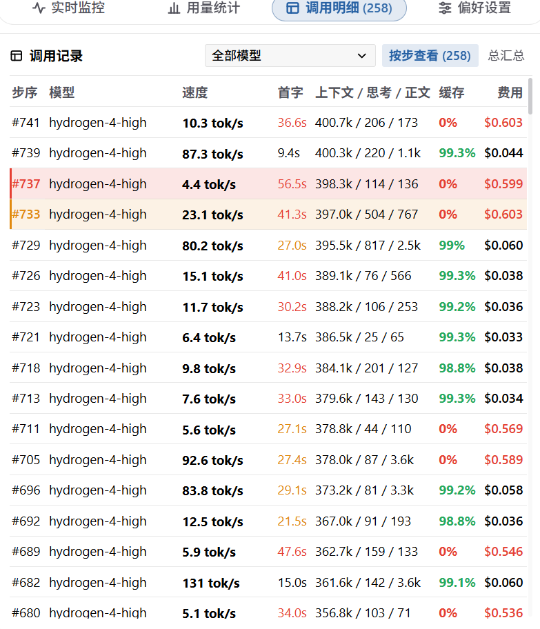
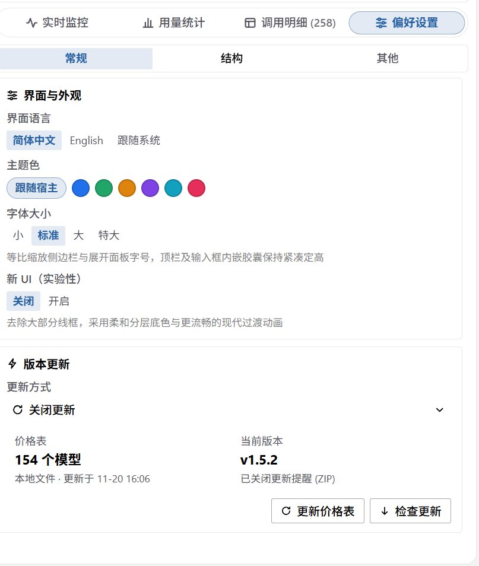
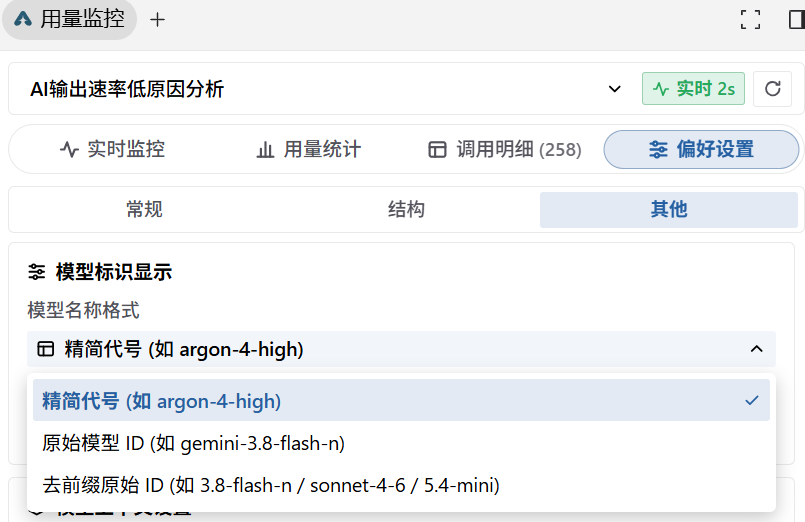

<div align="center">


# agy-monitor

**A full-surface usage, quota, and real-time decode speed monitor for Google Antigravity 2.0 Desktop, Antigravity IDE, and Antigravity CLI (`agy`) with zero external npm dependencies.**

> Forked and enhanced from [`yuhuan-dev/antigravity-usage-monitor`](https://github.com/yuhuan-dev/antigravity-usage-monitor) (`v1.5.2`) under **GPL-3.0-only**.  
> **UI Languages**: Built-in **简体中文**, **English**, and **System (Auto)** switching under **Settings -> Appearance**.

English | [简体中文](README.zh-CN.md)

[Preview](#ui-preview) · [What's New in This Fork](#whats-new-in-this-fork) · [Prerequisites & Setup](#prerequisites--configuration) · [Installation](#installation) · [Client Support](#client-support-matrix) · [Development](#local-development--testing)

</div>

---

## UI Preview



<table>
  <tr>
    <td align="center" width="33.3%">
      
      <br />
      <b>Call Details</b>
      <br />
      <sub>Per-step TPS, TTFT, Context / Thinking / Reply split, anomaly diagnostics &amp; cost</sub>
    </td>
    <td align="center" width="33.3%">
      
      <br />
      <b>Preferences &amp; Appearance</b>
      <br />
      <sub>简体中文 / English / System UI, 6 theme accents, font scaling &amp; safe update policy</sub>
    </td>
    <td align="center" width="33.3%">
      
      <br />
      <b>Model ID Formatting</b>
      <br />
      <sub>Compact slug, full upstream ID, or vendor-stripped ID switching</sub>
    </td>
  </tr>
</table>

---

## What's New in This Fork

- **Minimalist Live Decode Speed Badge Below the Composer Input**:
  - Mounts cleanly right below the bottom-right corner of the main chat input box (`pointer-events: none`, zero click interception, automatic light/dark adaptation).
  - **While streaming**: Pulses a green live dot and estimates real-time output speed via a `3.5s` sliding window (`<= 900ms` active polling) with EMA smoothing and flush-burst dampening.
  - **After completion**: Automatically switches to **TTFT-excluded pure Decode TPS** (`output / (totalDuration - nativeTtft)`), filtering out `< 1.0s` buffered tool-call steps that cause `1000+ tok/s` false spikes—without altering the main panel's end-to-end request throughput stats.
- **Fixes `Orchestrator (Neon)` (`orchestrator-carbon`) Mislabeling Bug**:
  - Fixed upstream placeholder/regex gaps (`MODEL_PLACEHOLDER_M537` / `gemini-pro-orchestrator-neon` and `MODEL_PLACEHOLDER_M532` / `Gemini 4 Neon`) where Pro users invoking Neon orchestrator calls were misclassified and rendered as `orchestrator-carbon` in both backend attribution and frontend labels.
- **Fork-Safe Update Defaults**:
  - Targets `llcc-bit/agy-monitor` and sets `pluginUpdateMode` to **`off`** by default so upstream releases will never accidentally overwrite your local customizations. You can still manually trigger **Check Updates** or **Update Pricing Catalog** anytime in **Settings**.

### Inherited Core Capabilities (`v1.5.2`)
- **Multi-Surface Non-Invasive Mounting**: Works as a titlebar/composer capsule + auxiliary sidebar in **Antigravity 2.0 Desktop**, a titlebar/composer capsule in **Antigravity IDE**, a 24-bit ANSI single-line `statusLine` in **Antigravity CLI (`agy`)**, and a **Standalone Web UI**—without modifying `app.asar`.
- **10-Category Context Window Breakdown**: Inspects model replies, tool results, user messages, subagent notices, checkpoints, system prompt, system tools, MCP tools, skills, and user rules, plus per-model custom context limit overrides.
- **Multi-Pool Quotas & 154+ Model Pricing Catalog**: Tracks 5-hour and weekly quotas across `Gemini`, `Gemini 4 Argon`, `Gemini 4 Carbon`, and `Claude & GPT`, with phased promotional pricing support.
- **Historical Analytics & Multi-Agent / Swarm Tracking**: Supports `Today`, `1d`, `7d`, `14d`, `30d`, `All`, and custom date ranges, hourly/daily trend curves, client source breakdown (`Desktop App` / `IDE` / `CLI`), and inline subagent/swarm inspection.
- **Offline SQLite + Transcript Reading**: Reads CLI SQLite + WAL databases, `annotations/*.pbtxt`, `transcript.jsonl`, and `.deep_stats_cache.json`.

---

## Prerequisites & Configuration

> [!IMPORTANT]
> Read these prerequisites before installing so topbar capsules, the composer speed badge, and CLI status lines work immediately on first launch.

### 1. Base Runtime Requirements
- **Completely Standalone**: You do **NOT** need to install or run the original Token Monitor or Usage Monitor.
- **Zero External `npm` Packages**: No `npm install` or build step is required before running—compiled `sidecars/panel/app.js` and `sidecars/panel/styles.css` are committed in the repository.
- **Node.js Runtime**:
  - Desktop & IDE sidecars run on Google Antigravity's built-in Node.js runtime.
  - For **Antigravity CLI (`agy`)** offline SQLite+WAL reading or **Standalone Web** mode, **Node.js 22.5+** (with built-in `node:sqlite`) is recommended.
- **Avoid Conflicts with Upstream `usage-monitor`**:
  - If you previously installed `yuhuan-dev/antigravity-usage-monitor` (`usage-monitor`), **disable** it in **Customizations -> Installed** before enabling **AGY Monitor** (`agy-monitor`) to prevent duplicate capsules. Both plugins safely share historical data under `~/.gemini/antigravity/sidecar_data/usage-monitor/panel/data/` (or `~/.gemini/antigravity-cli/...`), so disabling the old plugin preserves all your history.

### 2. Surface-Specific Host Configuration

| Surface | Required Prerequisite | How It Is Configured |
| --- | --- | --- |
| **Antigravity 2.0 Desktop (`2.33.0+`)** | Host must run with `--remote-debugging-port=0` so local CDP (`DevToolsActivePort`) is active for the titlebar capsule and bottom `tok/s` badge. | **Automatic**: The plugin patches Windows personal shortcuts (`.lnk`), `HKCU\...\Run`, `antigravity://` handler, or Linux `.desktop` files automatically. If your current session started without the flag (or uses a read-only All-Users shortcut), click **Relaunch Host** in the plugin notice banner / Settings. *(Sidebar-only mode works even without CDP.)* |
| **Antigravity IDE** | `"remote-debugging-port": "0"` in `~/.antigravity-ide/argv.json`. | **Automatic on first enable**: The zero-tool MCP keepalive helper adds `"remote-debugging-port": "0"` while preserving comments and existing settings. **Restart Antigravity IDE once** after enabling. |
| **Antigravity CLI (`agy`)** | `statusLine` command registered in `~/.gemini/antigravity-cli/settings.json` + Node.js 22.5+. | Toggle in **Settings** inside the panel, or run: `node ~/.gemini/config/plugins/agy-monitor/sidecars/panel/cli-statusline.mjs --install` |
| **Cloud Catalog / Update Sync *(Optional)*** | HTTPS access to `github.com` / `raw.githubusercontent.com`. | Core monitoring is 100% local and works offline. In proxy/restricted environments, ensure your system proxy or `HTTP_PROXY` / `HTTPS_PROXY` is set if you use **Update Pricing Catalog** or **Check Updates**. |

### 3. Optional Environment Variables
- `ANTIGRAVITY_GEMINI_DIR`: Override default `~/.gemini` root directory.
- `USAGE_MONITOR_DATA_DIR`: Override cache and settings storage directory.
- `AGY_CLI_AUTO_COMPACT_OVERRIDE`: Override CLI auto-compaction context window thresholds.

---

## Client Support Matrix

| Client / Environment | Capsule / Status Bar | Full Panel | Input-Box Live Speed Badge | Offline SQLite & Logs | Modifies `app.asar` |
| --- | :---: | :---: | :---: | :---: | :---: |
| **Google Antigravity 2.0 Desktop** | Titlebar / Composer | Hover Popover + Auxiliary Sidebar | Supported | Supported | No |
| **Google Antigravity IDE** | Titlebar / Composer | Click Capsule Popover | Supported *(when composer card is present)* | Supported | No |
| **Google Antigravity CLI (`agy`)** | Terminal `statusLine` | Standalone Web (`--port`) | — | Supported (`node:sqlite` + `.pbtxt`) | No |
| **Headless Server / SSH** | Terminal `statusLine` | SSH Tunnel / `--token` Web | — | Supported | No |

---

## Installation

> This is a **Google Antigravity native plugin** driven by `plugin.json` and `sidecars/panel/sidecar.json` (**not** a VS Code `.vsix` extension).

### Option A: Git Clone (Recommended)

**Windows (PowerShell):**
```powershell
$pluginsDir = "$env:USERPROFILE\.gemini\config\plugins"
New-Item -ItemType Directory -Path $pluginsDir -Force | Out-Null
git clone https://github.com/llcc-bit/agy-monitor.git "$pluginsDir\agy-monitor"
```

**macOS / Linux:**
```bash
mkdir -p ~/.gemini/config/plugins
git clone https://github.com/llcc-bit/agy-monitor.git ~/.gemini/config/plugins/agy-monitor
```

### Option B: Download ZIP

1. Click **Code -> Download ZIP** (or download from **Releases**).
2. Extract and ensure the folder is named **`agy-monitor`** with `plugin.json` directly inside it.
3. Place the folder at:
   - **Windows**: `C:\Users\<YourUsername>\.gemini\config\plugins\agy-monitor`
   - **macOS / Linux**: `~/.gemini/config/plugins/agy-monitor`

### Enable & Launch

1. Open Google Antigravity Desktop or IDE and go to **Customizations -> Installed**.
2. Disable **`Usage & Speed Monitor`** if previously installed, then enable **`AGY Monitor`** (`agy-monitor`).
3. You can also launch the standalone web dashboard anytime:
   ```bash
   node ~/.gemini/config/plugins/agy-monitor/sidecars/panel/standalone.mjs
   ```

---

## Local Development & Testing

If you edit frontend sources under `sidecars/panel/src/`, rebuild the classic bundles and run the full zero-dependency unit test suite:

```powershell
cd sidecars/panel

# Rebuild app.js and styles.css
node scripts/build-bundle.mjs

# Run all 171 unit tests
node --test test/*.test.mjs

# Optional: build a lean runtime-only ZIP into dist/agy-monitor.zip
node scripts/pack-release-zip.mjs
```

---

## License & Credits

- Based on [`yuhuan-dev/antigravity-usage-monitor`](https://github.com/yuhuan-dev/antigravity-usage-monitor) by `yuhuan-dev`.
- Licensed under **GNU General Public License v3.0 only (`GPL-3.0-only`)**. See [LICENSE](./LICENSE) for full terms and modification history.
