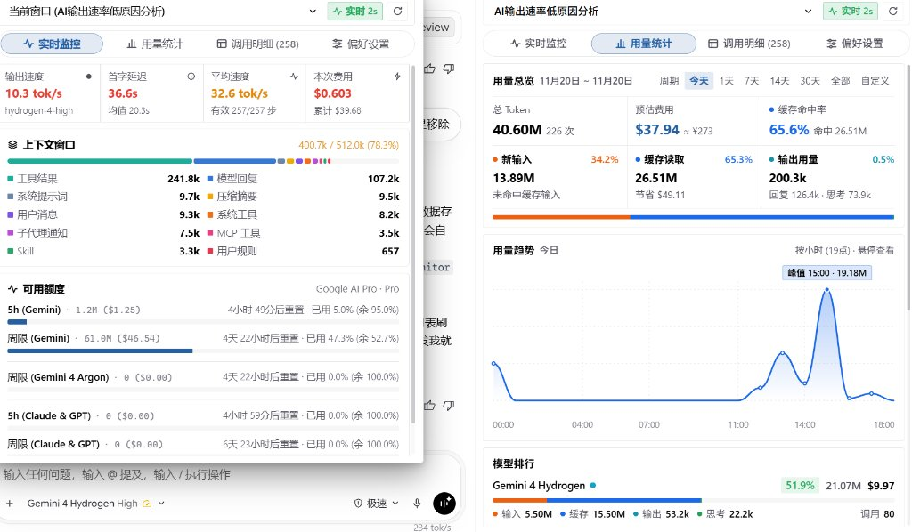
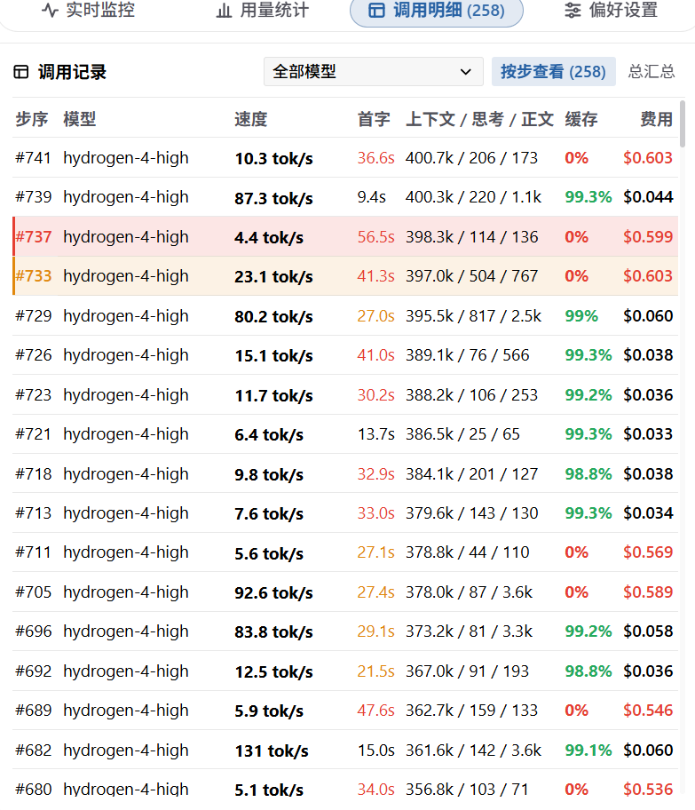
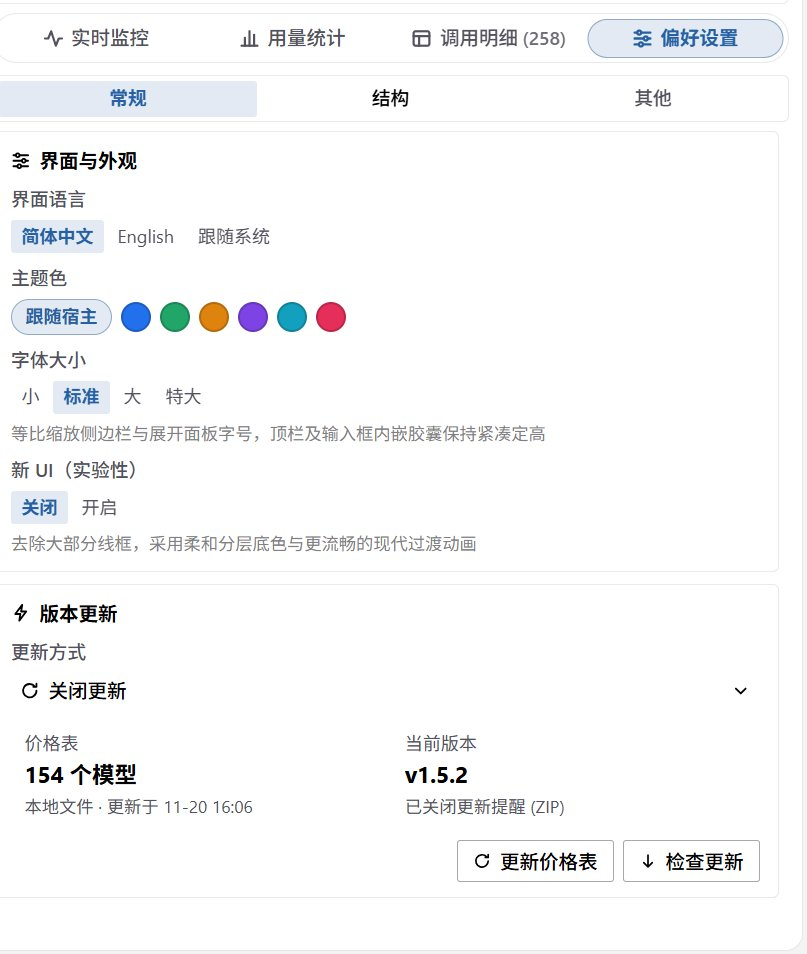
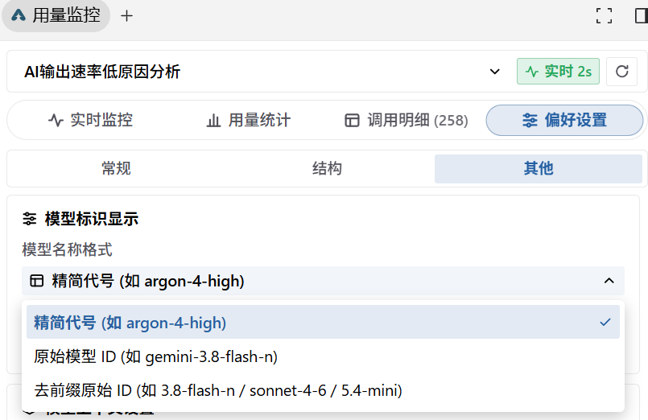

<div align="center">


# agy-monitor

**专为 Google Antigravity 2.0 桌面应用、Antigravity IDE 与 Antigravity CLI (`agy`) 打造的全端用量、配额与纯解码实时速率监控插件，零外部 `npm` 依赖。**

> 本项目基于 [`yuhuan-dev/antigravity-usage-monitor`](https://github.com/yuhuan-dev/antigravity-usage-monitor)（`v1.5.2`）二次开发，遵循 **GPL-3.0-only** 开源协议。  
> **界面语言支持**：内置多语言系统，可在 **偏好设置 -> 界面与外观** 中随时切换 **简体中文**、**English** 或 **跟随系统（Auto）**。

[English](README.md) | 简体中文

[界面预览](#界面预览) · [本仓库核心增强](#本仓库核心增强) · [前置依赖与配置说明](#前置依赖与配置说明) · [保姆级安装步骤](#保姆级安装步骤) · [客户端支持矩阵](#客户端支持矩阵) · [本地开发与测试](#本地开发与测试)

</div>

---

## 界面预览



<table>
  <tr>
    <td align="center" width="33.3%">
      
      <br />
      <b>调用明细</b>
      <br />
      <sub>单步 TPS、首字延迟、上下文 / 思考 / 正文拆解、异常行诊断与费用</sub>
    </td>
    <td align="center" width="33.3%">
      
      <br />
      <b>偏好设置与外观</b>
      <br />
      <sub>支持 简体中文 / English / 跟随系统、6 种主题色、字体缩放与安全更新策略</sub>
    </td>
    <td align="center" width="33.3%">
      
      <br />
      <b>模型标识格式</b>
      <br />
      <sub>支持精简代号、原始模型 ID 与去前缀原始 ID 一键切换</sub>
    </td>
  </tr>
</table>

---

## 本仓库核心增强

- **输入框下方极简实时吐字速率浮标**：
  - 精准贴合在主聊天输入框卡片正下方右侧（如 `234 tok/s`），无点击拦截（`pointer-events: none`），不遮挡任何按钮与输入，深浅色主题自动适配。
  - **流式生成中**：亮起绿色呼吸点，基于 `3.5s` 滑动窗口 + EMA 平滑实时估算当前吐字速率（运行态 `<= 900ms` 高频刷新，自动抑制后端批量刷盘瞬时毛刺）。
  - **生成完成后**：自动切换为扣除原生首字延迟（TTFT）后的**纯解码吐字速率（Decode TPS）**，自动跳过 `< 1.0s` 短缓冲工具调用导致的 `1000+ tok/s` 假峰值，同时完整保留原面板的端到端测速统计口径。
- **修复 Pro 用户 `Orchestrator (Neon)` 误显示为 `orchestrator-carbon` Bug**：
  - 修复上游未覆盖 `MODEL_PLACEHOLDER_M537`（`gemini-pro-orchestrator-neon`）与 `MODEL_PLACEHOLDER_M532`（`Gemini 4 Neon`）导致的前后端正则误判，彻底消除 Pro 用户调用编排模型时错误归类并显示为 `orchestrator-carbon` 的问题。
- **安全的分支更新默认策略**：
  - 将检查更新源锚定至本仓库 `llcc-bit/agy-monitor` 且默认设为**关闭更新（`off`）**，防止上游发布新版时自动覆盖你的定制改动；如需同步价格或手动发版更新，可在 **偏好设置 -> 版本更新** 中随时使用 **更新价格表** 或开启检查更新。

### 同步自上游 `v1.5.2` 的完整能力
- **全端无侵入挂载**：支持 **Antigravity 2.0 桌面端** 顶栏 / 输入框停靠胶囊与右侧辅助栏、**Antigravity IDE** 顶栏 / 输入框胶囊、**Antigravity CLI (`agy`)** 单行 24-bit ANSI 底部 `statusLine` 与 **独立 Web 页面**，全程不触碰宿主 `app.asar`。
- **十维上下文窗口构成与按模型上限设定**：实时展示模型回复、工具结果、用户消息、子代理通知、压缩摘要、系统提示词、系统工具、MCP 工具、Skill 与用户规则的占比变化，并支持按模型系列覆写上下文上限。
- **多池可用额度与 154+ 模型目录**：追踪 `Gemini`、`Gemini 4 Argon`、`Gemini 4 Carbon` 与 `Claude & GPT` 模型池的 5 小时/每周余量、重置倒计时与分阶段单价。
- **历史统计、蜂群/子代理联动与自定义列**：支持今日、1 天、7 天、14 天、30 天、全部及自定义区间，趋势折线、分模型排行、客户端来源（App / IDE / CLI）、主/子代理/蜂群追踪与自定义 Token 组合格式（如 `context:new:cache`）。
- **离线 SQLite 与日记日志读取**：直读 CLI SQLite + WAL、`annotations/*.pbtxt`、`transcript.jsonl` 与 `.deep_stats_cache.json`。

---

## 前置依赖与配置说明

> [!IMPORTANT]
> 安装前请先了解以下前置条件，可确保「顶栏悬浮胶囊」「输入框下方 `tok/s` 浮标」与「CLI 底栏」在首次启用后立刻正常工作。

### 1. 基础运行环境前置
- **完全独立运行**：**不需要**提前安装或运行原版 Token Monitor 或原版 Usage Monitor。
- **零第三方 `npm` 依赖，无需 `npm install`**：本仓库已内置编译好的前端静态资源（`sidecars/panel/app.js` 与 `sidecars/panel/styles.css`）。
- **无需打包 `.vsix`**：这是 Google Antigravity 原生插件，不是 VS Code 扩展。
- **Node.js 运行时要求**：
  - 桌面端与 IDE 插件直接使用 Antigravity 自带的 Node.js 运行时，无需额外安装；
  - 若使用 **Antigravity CLI (`agy`)** 离线读取 SQLite 数据库或独立运行 Web 端（`standalone.mjs`），建议系统安装 **Node.js 22.5+**（内置 `node:sqlite`）。
- **与原版插件共存注意**：
  - 如果你之前安装过原版 **`Usage & Speed Monitor`**（`usage-monitor`），启用 **`AGY Monitor`** 前请先在左侧 **自定义扩展 -> Installed** 中**禁用**原版开关，避免顶栏出现两个重复胶囊。
  - 两者会自动共用 `~/.gemini/antigravity/sidecar_data/usage-monitor/panel/data/` 下的历史缓存与设置，禁用原版**不会丢失任何历史记录**。

### 2. 各端宿主前置配置（CDP 调试端口与 CLI 状态栏）

| 运行端 | 所需前置条件 | 如何完成配置（绝大多数全自动） |
| --- | --- | --- |
| **Google Antigravity 2.0 桌面端 (`2.33.0+`)** | 需要以 `--remote-debugging-port=0` 参数启动宿主，开启本地 CDP（`DevToolsActivePort`），用于挂载顶栏悬浮窗与输入框下方 `tok/s` 浮标。 | **插件后台全自动补齐**：会自动为 Windows 个人桌面/开始菜单/任务栏 `.lnk` 快捷方式、开机自启及 `antigravity://` 协议（或 Linux `.desktop`）补上该参数。若当前窗口是以无参数裸启动打开的（或仅存在公共只读快捷方式），在面板顶部提示条或设置页点一下 **一键重启宿主** 即可生效；即使不开 CDP，**右侧辅助栏模式** 仍可正常使用。 |
| **Google Antigravity IDE** | 需要在 `~/.antigravity-ide/argv.json` 中启用 `"remote-debugging-port": "0"`。 | **首次启用自动写入**：后台会无损耗自动写入该字段并保留原有注释与配置；首次启用后**重启一次 IDE**，顶栏胶囊即可自动挂载。 |
| **Google Antigravity CLI (`agy`)** | 需要在 `~/.gemini/antigravity-cli/settings.json` 注册 `statusLine`（且建议 Node.js 22.5+）。 | 可在面板 **偏好设置** 中一键开启，或终端执行：<br>`node ~/.gemini/config/plugins/agy-monitor/sidecars/panel/cli-statusline.mjs --install` |
| **云端价格表 / 检查更新（可选）** | 仅在线同步 `pricing-catalog.json` 或手动检查更新时需要访问 `github.com` / `raw.githubusercontent.com`。 | 核心监控、速率统计与历史分析 **100% 本地运行，离线可用**；若在代理环境下需要云端更新价格表，确保系统代理或 `HTTP_PROXY` / `HTTPS_PROXY` 正常即可。 |

### 3. 可选高级环境变量
- `ANTIGRAVITY_GEMINI_DIR`：自定义 `~/.gemini` 根目录路径。
- `USAGE_MONITOR_DATA_DIR`：自定义插件缓存与偏好设置存储目录。
- `AGY_CLI_AUTO_COMPACT_OVERRIDE`：在 CLI 下覆写按模型生效的自动压缩上下文上限。

---

## 客户端支持矩阵

| 客户端 / 运行环境 | 状态胶囊 / 底栏 | 监控面板 | 输入框下方实时浮标 | 离线 SQLite 与日志读取 | 修改 `app.asar` |
| --- | :---: | :---: | :---: | :---: | :---: |
| **Google Antigravity 2.0 桌面端** | 顶栏 / 输入框停靠 | 悬浮窗 + 右侧辅助栏 | 支持 | 支持 | 否 |
| **Google Antigravity IDE** | 顶栏 / 输入框停靠 | 点击胶囊展开面板 | 支持（检测到输入框卡片时） | 支持 | 否 |
| **Google Antigravity CLI (`agy`)** | 终端底栏 `statusLine` | 独立 Web (`--port`) | — | 支持（`node:sqlite` + `.pbtxt`） | 否 |
| **无头服务器 / SSH 远程** | 终端底栏 `statusLine` | SSH 隧道 / `--token` Web | — | 支持 | 否 |

---

## 保姆级安装步骤

### 第 1 步：放到 Antigravity 插件目录

#### 方式 A：Git 克隆（推荐）

**Windows（PowerShell）：**
```powershell
$pluginsDir = "$env:USERPROFILE\.gemini\config\plugins"
New-Item -ItemType Directory -Path $pluginsDir -Force | Out-Null
git clone https://github.com/llcc-bit/agy-monitor.git "$pluginsDir\agy-monitor"
```

**macOS / Linux：**
```bash
mkdir -p ~/.gemini/config/plugins
git clone https://github.com/llcc-bit/agy-monitor.git ~/.gemini/config/plugins/agy-monitor
```

#### 方式 B：直接下载 ZIP 压缩包

1. 在 GitHub 仓库页点击 **Code -> Download ZIP**（或前往 **Releases** 下载压缩包）。
2. 解压后将文件夹重命名为 **`agy-monitor`**，确保里面直接包含 `plugin.json`。
3. 将 `agy-monitor` 文件夹放到对应系统的插件目录：
   - **Windows**：`C:\Users\<你的用户名>\.gemini\config\plugins\agy-monitor`
   - **macOS / Linux**：`~/.gemini/config/plugins/agy-monitor`

### 第 2 步：启用并使用

1. 打开 Google Antigravity 桌面版或 IDE，进入左侧边栏 **自定义扩展（Customizations）-> Installed**。
2. 如已安装原版 **`Usage & Speed Monitor`**，先将其**禁用**；再开启 **`AGY Monitor`**（`agy-monitor`）。
3. **打开界面**：
   - **顶栏双栖悬浮模式（默认）**：右上角自动出现实时状态胶囊，悬停速览，左键打开完整四标签面板，主聊天输入框右下角同步显示实时 `tok/s`。
   - **右侧辅助栏**：点击右上角扩展入口或输入「打开用量监控面板」即可固定展开。
   - **独立 Web 页面**（终端/远程查看）：
     ```bash
     node ~/.gemini/config/plugins/agy-monitor/sidecars/panel/standalone.mjs
     ```

---

## 本地开发与测试

如果你修改了 `sidecars/panel/src/` 下的前端源码，请在 `sidecars/panel` 目录重新编译并运行完整测试：

```powershell
cd sidecars/panel

# 重新打包前端 app.js 与 styles.css
node scripts/build-bundle.mjs

# 运行全部 171 项单元测试（零第三方依赖）
node --test test/*.test.mjs

# 可选：打包精简运行态压缩包（输出至 dist/agy-monitor.zip）
node scripts/pack-release-zip.mjs
```

> 提示：在开启脚本限制的 Windows PowerShell 环境中若 `npm test` 受限，直接使用上述 `node` 命令即可正常运行。

---

## 开源协议与致谢

- 本项目基于 [`yuhuan-dev/antigravity-usage-monitor`](https://github.com/yuhuan-dev/antigravity-usage-monitor) 二次开发，特此向原作者 `yuhuan-dev` 致谢。
- 依据上游许可证要求，本项目继续完整遵循 **GNU General Public License v3.0 only (`GPL-3.0-only`)** 开源，详见 [LICENSE](./LICENSE)。
